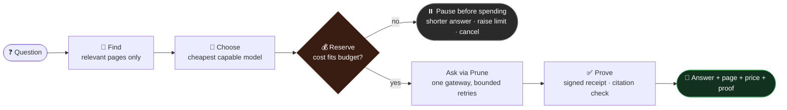
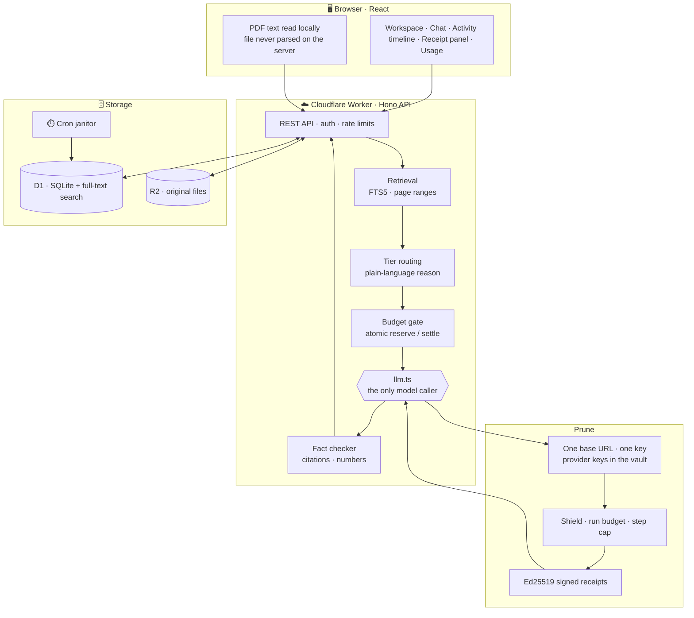
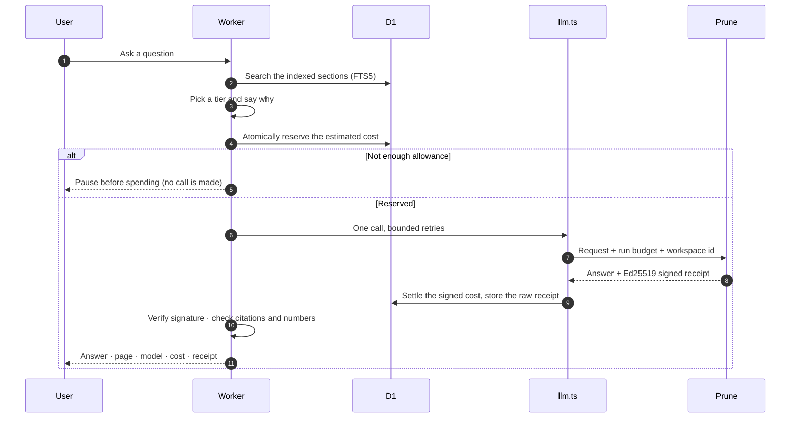

<div align="center">


<a href="#-the-solution">
  
</a>

<br/>


**[The problem](#-the-problem)** · **[The solution](#-the-solution)** · **[Results](#-measured-results)** · **[Architecture](#-architecture)** · **[Quick start](#-quick-start)** · **[Status](#-project-status)**

</div>

---

> ### *"What did the last AI answer you got actually cost?"*
> Not roughly. Exactly. Nobody knows: not the user, not the finance team, usually not even the developer who built the app.
> **Athena exists to answer that question on every single response.**

---

## 🔥 The problem

AI on documents fails in four quiet, expensive ways.

| | The pain | What it looks like |
|:-:|---|---|
| 💸 | **Cost climbs with every question** | Most tools resend the whole document and the whole chat on every question. On our benchmark the naive approach sends **10,639 prompt tokens per question**, and it keeps growing with each follow-up. |
| 🙈 | **Cost is invisible** | No price and no model name on the answer. You find out when the invoice arrives. |
| 🔁 | **Failures cost money** | A timeout fires a blind retry. A crash bills you twice for work you already paid for. |
| 🔓 | **Trust is weak** | PDFs can hide instructions, provider keys end up in code, and nobody can prove what was spent. |

These aren't edge cases. They're the default.

---

## ✨ The solution

**Athena reads a document once, sends only the parts that matter, picks the cheapest model that can do the job, checks your budget *before* every call, and proves the cost of every answer with a signed Prune receipt.**

Every question runs through five visible steps, shown live in the app as an activity timeline:



### What every answer comes with

```text
┌──────────────────────────────────────────────────────────────────────┐
│  The customer must pay each invoice within 45 days of the invoice    │
│  date. [p.5]                                                         │
├──────────────────────────────────────────────────────────────────────┤
│  Economy · Why this model: short lookup · Citation check passed      │
│   Prune receipt · Ed25519 signed            [ Verify receipt ]      │
│                                                                      │
│  How this cost was calculated                                        │
│    2,102 tokens in  × price per 1M  =  input cost                    │
│       59 tokens out × price per 1M  =  output cost                   │
│    Calculated total  ·  Charged  ·  ✓ matches                        │
└──────────────────────────────────────────────────────────────────────┘
```
<sub>Illustrative layout of the answer card and receipt panel.</sub>

---

## 🧠 What makes Athena different

| | Capability | Why it matters |
|:-:|---|---|
| 🛡️ | **Money is a limit, not a report** | Cost is *reserved atomically before* the call. If it can't be afforded, nothing is sent. A crash or a race can't overspend. |
| 🧾 | **A Prune receipt on every answer** | Each call is Ed25519-signed by Prune. Athena stores the receipt byte for byte, verifies it locally and with Prune's hosted check, and exports it for anyone to re-verify. |
| 🧮 | **Click-to-verify cost** | Every answer shows its cost and how it was reached. **Verify** rechecks it on the server, with no trust required. |
| 🎯 | **Cost per *good* answer** | Retries, escalations and failures are counted, then divided by answers that pass the citation check. The honest metric. |
| 🔍 | **A free fact checker** | Deterministic code checks that every cited page was in the text sent and every number appears on that page. **$0, no second model.** |
| 🧯 | **Failure by design** | Bounded retries; no retry on bad keys, empty budgets, Prune Shield blocks or uncertain billing; finished work is saved; the app pauses with options. |
| ✅ | **Prune does real work** | One base URL, provider keys in the Prune vault, server-side run budgets and step caps, Shield, per-workspace cost attribution, and signed receipts as the source of truth for cost. |

---

## 📊 Measured results

> Every number below comes from our own runs. Nothing is projected.

<table>
<tr>
<td width="50%" valign="top">

### ⚔️ Head-to-head
*Same 20-page contract, same 8 questions, live model calls*

| | Whole document → strongest model | **Athena** |
|---|:-:|:-:|
| Prompt tokens | 36,208 | **14,106** (−61%) |
| Cost | $0.0057 | **$0.0034** (−40%) |
| Correct | 8 / 8 | 7 / 8 |

<sub>Athena missed one question by taking a decoy clause from another page. We report it rather than hide it.</sub>

</td>
<td width="50%" valign="top">

### 📚 Where the naive way breaks
*40-page contract, 8 back-to-back questions*

| | Result |
|---|:-:|
| Naive approach | ❌ **Rejected as too large** (8,823 tokens > 8,000/min limit) |
| **Athena** | ✅ **8 / 8 correct** |
| Right page cited | **8 / 8** |
| Cost per answer | **≈ $0.0005** |

</td>
</tr>
</table>

| Metric | Result | Source |
|---|---|---|
| Prompt size per question | **2,134** tokens vs **10,639** naive (**80% smaller**) | Benchmark: 2 × 30-page agreements, 20 questions |
| Fact checker: good answers passed | **24 / 25** (96%) | 46 hand-labelled answers, `athena/reports/gate_eval.json` |
| Fact checker: bad answers caught | **14 / 21** (67%) with **zero model calls** | Same set; what it misses is published |
| Real signed Prune receipt | ✅ Verified locally (Ed25519) **and** by Prune's hosted verifier | Phase 0, `athena/PHASE0-FINDINGS.md` |
| Automated tests | **204 passing** | `npm run check` |

<sub>Token counts are exact. Dollar figures in the head-to-head use our configured tier prices.</sub>

---

## 🏗️ Architecture



<details>
<summary><b>🔬 One question, step by step (sequence)</b></summary>



</details>

<details>
<summary><b>🧯 Failure handling</b></summary>

| Situation | What Athena does |
|---|---|
| Timeout before sending | Retry with backoff, within a fixed attempt limit |
| Connection drops **after** sending | Charge the estimate, mark billing uncertain, **never retry blindly** |
| Rate limit (429) | Wait the **full** time requested; if it won't fit, stop and say how long |
| Bad key, empty budget, Prune Shield block | Stop at once: no retry, nothing charged |
| Two requests race for the last cents | Atomic reservation: one proceeds, one pauses |
| Duplicate submission | Refused by idempotency key before anything is sent |
| Hidden instructions in a PDF | Document text fenced as data; output scanned for secrets and foreign links |
| Kill switch on | Every call refused before anything is reserved |

</details>

---

## 🧰 Tech stack

<div align="center">


</div>

---

## 🚀 Quick start

> Runs fully offline against a mock Prune that signs real Ed25519 receipts. No accounts needed. Requires **Node 24** (built-in `node:sqlite` and TypeScript type stripping).

```bash
cd athena && npm install && npm --prefix web install
npm run check            # typecheck · 204 tests · single-caller guard · web typecheck
npm run dev:stack        # API + mock Prune        (terminal 1)
npm run web              # http://127.0.0.1:5173   (terminal 2)
```

<details>
<summary><b> Run on the real Prune</b></summary>

Put your Prune key in `athena/.env` or `athena/.dev.vars` (both gitignored), never in code. Provider keys live in the Prune vault, not here.

```bash
PRUNE_API_KEY=prune_...
```

When deployed, set it as a Worker secret: `npx wrangler secret put PRUNE_API_KEY`.
A CI guard (`npm run check:caller`) fails the build if any file except `llm.ts` touches a model host, or if a key appears in code.

</details>

<details>
<summary><b>🧾 Verify receipts yourself</b></summary>

Export receipts from the Usage screen, then:

```bash
python bench/verify.py athena-receipts.jsonl
# or
node scripts/verify-receipts.mjs athena-receipts.jsonl
```

</details>

---

## 🗺️ Repository map

| Path | What |
|---|---|
| [`athena/`](athena) | **The code:** Cloudflare Worker backend (`src/`), React app (`web/`), mock Prune, tests, benchmark. Start at [`athena/README.md`](athena/README.md) |
| [`STATUS.md`](STATUS.md) | Project status, the four workstreams with file ownership, and the phases (**read this first**) |
| [`memory.md`](memory.md) | The team's agreed product scope, flow, safety controls and build order (source of truth) |
| [`athena.md`](athena.md) | Technical plan: architecture, database, API, tests, benchmark |
| [`prune.md`](prune.md) | Notes on integrating with Prune |
| [`athena-content.md`](athena-content.md) | Website and in-app copy |
| [`docs/pitch.md`](docs/pitch.md) | Pitch deck content, script and judge Q&A |
| [`CONTRIBUTING.md`](CONTRIBUTING.md) | How we avoid merge conflicts |
| [`status/`](status) | One status file per team member |
| [`docs/archive/`](docs/archive) | Earlier plans kept for reference |

---

## 📍 Project status

| Area | ✅ Built and tested | 🛣️ Next |
|---|---|---|
| **Documents** | Text PDFs indexed once with pages, retrieval, page citations, invoice pack with total check | OCR for scanned pages; whole-document summaries |
| **Models** | Three tiers with plain-language reasons, one escalation on a failed check, all through Prune | Routing evaluated on a mixed task set |
| **Money** | Atomic reserve and settle, per-call cap, allowance, pause with options, kill switch, cost per good answer | Reconcile uncertain charges against receipts |
| **Proof** | Raw receipt storage, Ed25519 verify, Prune hosted fallback, click-to-verify cost, export, offline verifier | Full receipts-backed benchmark |
| **Safety** | Fenced document text, output scanner, injection suite, single-model-caller guard, rate limits | Cross-user isolation audit |
| **Product** | Landing page, workspace, chat with citations, live activity timeline, usage panel | Chat without a document; Markdown checkpoint near the limit |

**Verified on live services:** a real signed Prune receipt, checked locally and by Prune's hosted verifier. **Not yet:** a full receipts-backed benchmark on every arm. We only claim what we've measured.

---

<div align="center">

### Know the price before you pay. Prove it after.

<sub>Built for FORGE · Ship It Lean: AI Apps on a Budget ·  Powered by Prune</sub>


</div>
